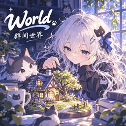
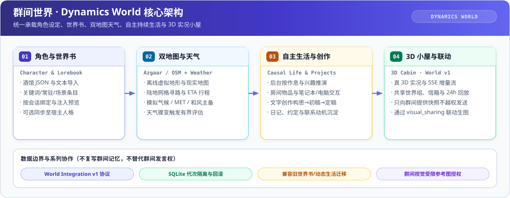

# 群间世界 · Dynamics World

**群间系列角色设定与持续生活引擎：统一承载角色卡、世界书、双地图天气、自主日程与 3D 实况小屋。**

[核心能力](#核心能力) · [系列联动](#与群间系列的联动) · [快速开始](#快速开始) · [群间系列生态](#群间系列生态) · [文档与许可](#进阶文档与许可)

---

## 核心能力

- **角色卡与世界书**：统一编辑多张角色卡与关键词/常驻/场景世界书条目，支持酒馆 JSON 与文本导入、会话绑定与注入预览，并可按需同步角色设定至 AstrBot 宿主人格。
- **自主持续生活与文字创作**：角色在后台按作息、兴趣与位置推进日常行动、日记、约定与联系动机；支持跨日延续的文字创作项目（构思 → 初稿 → 逐段修订 → 定稿），仅在行动完成后持久化状态。
- **虚拟与现实双地图 + 天气昼夜**：内置离线 Azgaar 虚拟地形生成器与 OpenStreetMap 现实地图双模独立保存，支持陆地网格寻路与 ETA 行程估算；天气支持模拟气候以及 MET Norway / Open-Meteo / 和风天气自动主备切换，天气骤变可触发有界生活评估。
- **房间物品与 3D 实况小屋**：管理房间遮蔽、饮水补给与物品交互（读物、雨伞、水壶、纸质笔记本、固定电脑），提供真 3D 实况拍立得、平滑避障寻路、原生 SSE 实时增量流、共享世界组、院门信箱与 24 小时时间轴回放。

## 与群间系列的联动

- **群间 · Chat Dynamics**：通过 World Integration v1 协议提供角色资料、环境天气、场景物品、创作进度与画面分享条件；**本插件不越权主动发群消息**，发言与发送权限始终由群间统一裁决。
- **群间视觉 · Visual Media**（可选）：通过 `visual_sharing` 条件与受限参考图目录授权，在获准回复回合中让主模型自然复用生图与角色参考工具。
- **群间记忆 · Dynamics Memory**：清晰区分角色虚构生活与真实成员事实，互不复制数据库，不把未完成计划写成已发生经历。

## 快速开始

1. 在 AstrBot（`>=4.29.4,<5`）安装本插件与配套 **群间 · Chat Dynamics**；若曾启用旧世界书或动态生活插件，请先停用以避免重复注入。
2. 打开 **「群间世界」** 面板的 **安装引导**：新建或导入角色与世界书、选择生活模型与会话范围、初始化轻量起始地点或生成地图（生成详细地形需安装 Playwright Chromium），确认无误后开启「接入聊天与推进生活」。
3. 新装默认空世界、通用画风、关闭接入，不自动植入角色或发起后台模型调用。如需从旧世界书与动态生活迁入，可在面板「迁移」页执行只读预览后导入（或使用 `migration.py` 离线校验迁移）。

### 常用管理命令

- `/群间世界`（管理员）：查看当前世界与角色生活状态摘要。
- `/群间日常 [完整|重新生成|推进|暂停|恢复]`（管理员）：查看或控制配置角色的持续生活推进。

---

## 群间系列生态

| 插件 | 仓库与标识 | 核心定位 |
| --- | --- | --- |
| **群间 · Chat Dynamics** | [`astrbot_plugin_chat_dynamics`](https://github.com/ysyhlly/astrbot_plugin_chat_dynamics) | 核心对话调度层：碎发聚合、话题路由、参与决策与节奏交付 |
| **群间世界 · Dynamics World**（当前） | [`astrbot_plugin_dynamics_world`](https://github.com/ysyhlly/astrbot_plugin_dynamics_world) | 角色卡、世界书、双地图天气、持续生活、创作项目与 3D 实况小屋 |
| **群间记忆 · Dynamics Memory** | [`astrbot_plugin_dynamics_memory`](https://github.com/ysyhlly/astrbot_plugin_dynamics_memory) | 长期记忆、混合召回、2D/3D 图谱与原文证据冲突审查 |
| **群间学习 · Dynamics Learning** | [`astrbot_plugin_dynamics_learning`](https://github.com/ysyhlly/astrbot_plugin_dynamics_learning) | 固定性格红线下的成员资料、黑话好感与可回滚审查学习 |
| **群间见闻 · Dynamics Horizons** | [`astrbot_plugin_dynamics_horizons`](https://github.com/ysyhlly/astrbot_plugin_dynamics_horizons) | 角色隔离外部信息源与书架、自主精读与分群待讨论话题 |
| **群间游戏 · Dynamics Games** | [`astrbot_plugin_dynamics_games`](https://github.com/ysyhlly/astrbot_plugin_dynamics_games) | 共读/约局/接龙/挑战/共创协作与四大群聊娱乐引擎 |
| **群间史记 · Dynamics Chronicle** | [`astrbot_plugin_group_chronicle`](https://github.com/ysyhlly/astrbot_plugin_group_chronicle) | 原文依据的长期群史卷册、人物传记与群文化梗沿革 |
| **群间视觉 · Visual Media** | [`astrbot_plugin_visual_media`](https://github.com/ysyhlly/astrbot_plugin_visual_media) | 表情收集检索、多模态生图改图与角色视觉形象管理 |

---

## 进阶文档与许可

- [发布说明](RELEASE_NOTES.md) · [更新日志](CHANGELOG.md) · [持续生活说明](CAUSAL_LIFE.md) · [创作项目](CREATIVE_PROJECTS.md) · [房间与视觉设计](ROOM_DESIGN.md)
- 交流与反馈：项目反馈群兼聊天群 QQ `203363132`
- 上游来源与署名见 [NOTICE.md](NOTICE.md)；本插件源代码沿用 [AGPL-3.0 License](LICENSE)。
- **单独素材许可（非商业性使用限制）**：3D 实况小屋「海边鲸鱼娘」主题随附的角色挂画素材（`pages/world/deepseek-whale-maid.jpg`，Pixiv 作品 148186519，角色原型「溟月」：上善无形；设计及立绘：ZipZipPipe）**不适用 AGPL-3.0**，而单独适用 [CC BY-NC-SA 4.0](https://creativecommons.org/licenses/by-nc-sa/4.0/deed.zh-hans)（署名、**非商业性使用**、相同方式共享），完整署名、来源与 SHA-256 校验声明见 [pages/world/whale-art-credit.txt](pages/world/whale-art-credit.txt)。如需商业用途或仅按 AGPL-3.0 分发，请移除或替换该挂画素材。
